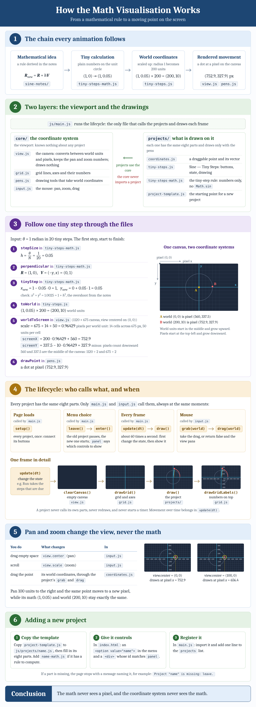

# Math Visualisation

The picture is a screenshot of [docs/how-it-works.html](docs/how-it-works.html).
When the code changes, update the page and its screenshot together.

How a project is built: [docs/project-template-note.html](docs/project-template-note.html) ([picture](docs/project-template-note.png)).

To run the program, open a terminal in this folder, run `npx serve`,
and open the address it prints. Double-clicking `index.html` does not work,
because the JavaScript files load each other as modules.
